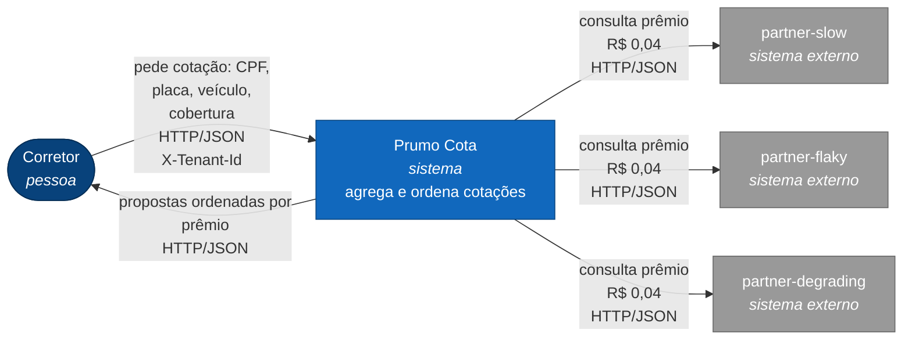
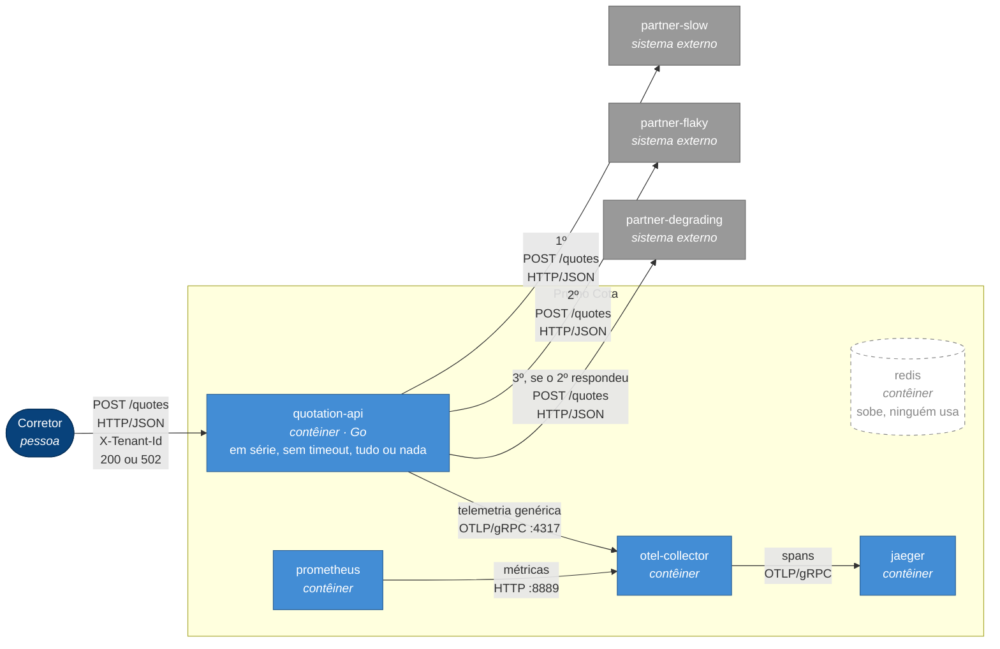
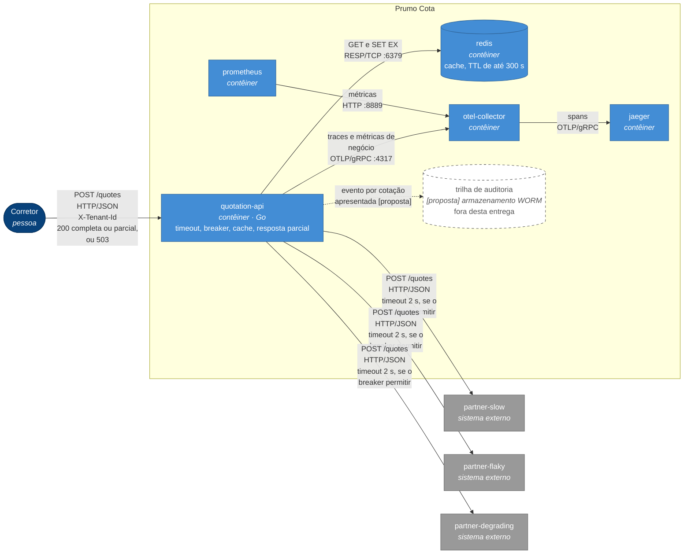
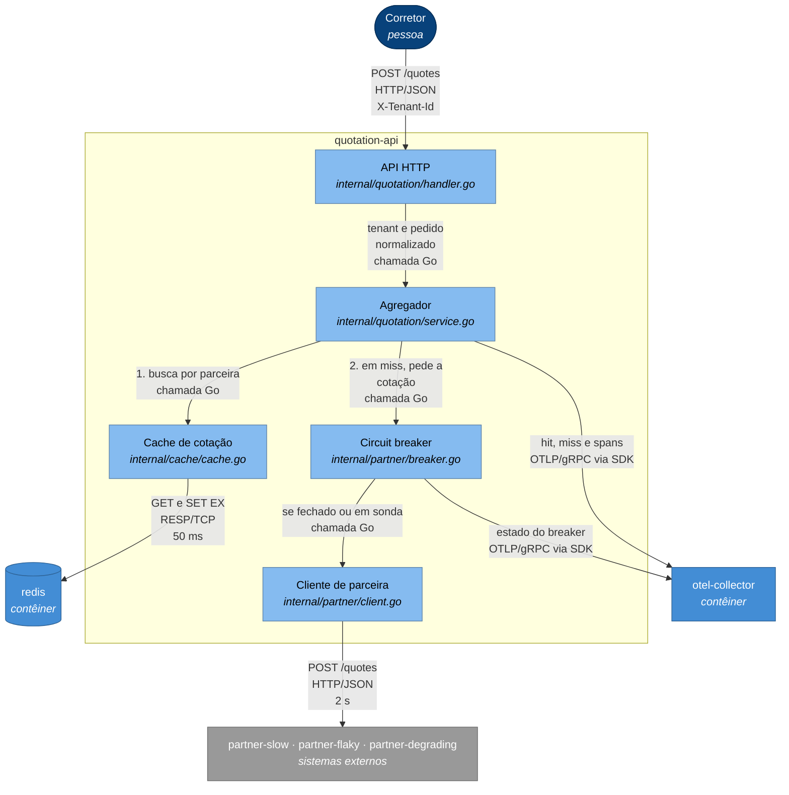

# SAD — Prumo Cota: proteção da fronteira com as seguradoras

**[proposta]** marca o que não foi implementado nesta entrega. O resto aponta para um arquivo real, para o enunciado (`docs/enunciado.md`) ou para uma medição em `docs/evidencias/`.

**Problema.** A API consulta três seguradoras em série e sem timeout, e qualquer falha derruba a cotação inteira. Cada consulta custa R$ 0,04, mesmo quando repete uma cotação recente.

**Decisão.** Proteger a fronteira com timeout, circuit breaker por parceira, cache isolado por corretora e resposta parcial. A agregação continua em série: o paralelismo é bônus e ficou de fora.

**Resultado medido.** Na carga padrão, sucesso de 60% para 100%, p95 de 8,01 s para 198 ms. A carga repete 5 cotações, então o cache explica boa parte do p95; o pior caso sem cache é de cerca de 3,9 s (RNF-01).

**Veredito.** Com 25% de recotação, o investimento se paga em cerca de 1 mês; com 10%, em cerca de 3 meses (§8.4). Os 25% são estimativa.

---

## 1. Introdução

### 1.1 Propósito e escopo

Este documento sustenta a decisão de investir na proteção da fronteira. Serve ao CTO (§8), a quem opera (§6 e §7) e ao encarregado de dados e auditoria (§4.2, §4.3 e §4.5).

- **Dentro:** `quotation-api` e sua fronteira com as seguradoras, cache, contrato de resposta degradada, instrumentação e a auditoria como decisão.
- **Fora:** motor de precificação, CRM da corretora, UI, cadastro e cobrança.
- **Citados, não implementados:** retry, bulkhead, rate limiting, fila, autenticação, Kubernetes e persistência real de auditoria (fora de escopo pelo enunciado).

### 1.2 Restrições e decisões

| Restrições (impostas pelo enunciado) | Decisões (deste documento) | Onde |
|---|---|---|
| Go 1.25, Compose, Redis, OpenTelemetry, Mermaid | Timeout de 2000 ms | §4.1 |
| Parceiras de `cmd/partner-mock/`, sem alteração | Breaker por parceira: 5 falhas / 10 s / 2 sucessos | §4.1 |
| R$ 0,04 por consulta; 120.000 cotações por dia útil; 22 dias úteis | Cache por parceira, TTL de até 300 s | §4.2 |
| Prêmio honrado por até 24 h | Resposta parcial; 503 se faltarem as três | §4.3 |
| Auditoria por 5 anos, não regravável (SUSEP) | Hospedagem: nuvem pública com região no Brasil | §5.3 |
| Prumo é operadora; proibido uso cruzado (LGPD) | | |

### 1.3 Pressupostos

| ID | Pressuposto | Valor | Origem | Se for falso |
|---|---|---|---|---|
| P1 | Cotações que repetem a mesma corretora e o mesmo risco em até 300 s | 25% (base); 10% (conservador) | Estimativa; não encontrei número público | Com 10%, a economia cai de R$ 79.200 para R$ 31.680 por mês (§8.1) |
| P2 | Toda chamada é cobrada, inclusive 503 e timeout | R$ 0,04 | Leitura conservadora do enunciado | Se só 200 for cobrado, o breaker não economiza em reais; continua valendo por latência |
| P3 | Volume em 10 h úteis, com pico de 3× a média | 3,3 cotações/s; pico de 10/s | 120.000 do enunciado; 10 h e 3× são estimativa | Muda o custo de cada abertura do breaker e o tamanho do Redis; agrava o limite L1 |
| P4 | Seguradoras honram a validade declarada | 300 s | `PARTNER_QUOTE_TTL_SECONDS` em `cmd/partner-mock/config.go` | Validade menor reduz o TTL e o hit rate |
| P5 | Registro de auditoria por cotação apresentada, com volume constante por 5 anos | 1,5 KB; 2.640.000 cotações/mês | Estimativa sobre os campos da §4.5; volume do enunciado | O custo é proporcional; 10× ainda não muda o veredito (§8.2) |
| P6 | Os dados ficam no Brasil | Residência no Brasil | Decisão de contrato. As fontes consultadas indicam que a LGPD regula a transferência internacional, sem impor localização; falta validar com o jurídico | Outras regiões entram na decisão de hospedagem (§5.3) |

O hit rate medido em carga **não** entra na conta de custos: o `make reproduce` repete 5 cotações e não descreve produção.

---

## 2. Visão geral

A arquitetura serve à corretora, que passa a receber as propostas disponíveis em vez de um erro, e à Prumo, que para de comprar consultas repetidas.

### 2.1 Contexto (C4 nível 1)

A Prumo intermedeia e não precifica. O contexto é o mesmo antes e depois da intervenção.



### 2.2 Contêineres antes (C4 nível 2)

Nomes de `docker-compose.yml`.



### 2.3 Contêineres depois (C4 nível 2)

Nenhum contêiner novo: liga o `redis` existente e muda o comportamento da API. A auditoria é tracejada porque não faz parte desta entrega.



### 2.4 O que muda

- **Entra:** timeout, breaker por parceira, cache no Redis, campos `degraded` e `missing` na resposta, métricas e marcações de trace.
- **Muda:** "houve falha" deixa de ser o primeiro erro e passa a ser "nenhuma parceira entregou proposta".
- **Sai da API:** o tudo ou nada e o 502. O comportamento antigo só existe em `NewService`, usado pelos testes que vieram com o repositório (§5.2).

---

## 3. Requisitos

### 3.1 Funcionais

| ID | Requisito | Origem | Como verificar |
|---|---|---|---|
| RF-01 | Sem `X-Tenant-Id` responde 400; corretora fora de `TENANTS` responde 403 | `internal/quotation/handler.go` | `internal/quotation/handler_test.go` |
| RF-02 | Corpo inválido ou campo ausente responde 400 com a mensagem de `Normalize` | `internal/quotation/request.go` | `internal/quotation/request_test.go` |
| RF-03 | Propostas ordenadas por `premium_cents` crescente, inclusive em resposta parcial | `internal/quotation/service.go` | `TestPartialResponseSaysWhoIsMissingAndWhy` |
| RF-04 | `X-Tenant-Id` volta em toda resposta 200 | `internal/quotation/handler.go` | `TestPartialResponseIs200AndEchoesTheBroker` |
| RF-05 | Toda cotação apresentada gera registro de auditoria retido por 5 anos, não regravável | SUSEP | [proposta] (§4.5) |
| RF-06 | Proposta de cache mantém o `quote_id` original, que a liga à consulta que a originou | SUSEP | `TestRepeatedQuotationComesFromTheCacheKeepingTheOriginalQuoteID` |
| RF-07 | Com ao menos uma proposta, responde 200 com `degraded: true` e as ausentes em `missing` | §4.3 | `TestPartialResponseSaysWhoIsMissingAndWhy` |
| RF-08 | Sem nenhuma proposta, responde 503 `no partner insurer available` | §4.3 | `TestNoPartnerAnsweringIsAnExplicitBusinessError` |
| RF-09 | Uma corretora nunca recebe entrada de cache gravada por outra | §4.2; LGPD | `TestCacheNeverCrossesBrokers` |
| RF-10 | Com o breaker aberto, nenhuma requisição sai para a parceira | §4.1 | `TestOpenBreakerDoesNotCallThePartner` |

### 3.2 Não funcionais

"Hoje" e "depois" vêm de `make down && make reproduce`, carga padrão: `docs/evidencias/antes-make-reproduce.txt` e `docs/evidencias/depois-make-reproduce.txt`.

| ID | Métrica | Hoje | Depois | Alvo | Método | Por que este alvo |
|---|---|---|---|---|---|---|
| RNF-01 | p95 do `POST /quotes` sob carga | 8,01 s | 198 ms | ≤ 4 s | Relatório do loadgen e `http_server_request_duration_seconds` | Pior caso em miss, em série: 1,7 + 0,2 + 2,0 = 3,9 s |
| RNF-02 | `POST /quotes` válidos com 200 | 60% (120/200) | 100% (200/200) | ≥ 99% | Relatório do loadgen | Só falha se as três faltarem; 1% de folga para a infraestrutura |
| RNF-03 | Vazão sob carga, 50 em voo | 8,1 req/s | 820,1 req/s | ≥ 10 req/s | Relatório do loadgen | Pico de P3 |
| RNF-04 | Consultas a parceiras ÷ cotações | 3 quando todas respondem | 0,27 (57/210), propriedade da carga | ≤ 2,25 em produção | `sum(increase(http_client_request_duration_seconds_count[1h])) / sum(increase(http_server_request_duration_seconds_count{http_route="/quotes"}[1h]))` | 3 × (1 − 25% de P1); alimenta a §8 |
| RNF-05 | Falhas de uma parceira até abrir o breaker | sem limite | 5 | ≤ 5 falhas por réplica | `TestBreakerOpensOnTheFifthConsecutiveFailureOfTheFlakySequence` | Limiar da §4.1. Chamadas já em voo não voltam atrás (L1) |
| RNF-06 | CPF, placa ou `quote_id` em span ou métrica | n/a | 0 | 0 | `TestNoPersonalDataInSpanAttributes` e `curl localhost:9090/api/v1/labels` | Telemetria é dado retido; placa em rótulo não tem teto de cardinalidade |

**Limite de medição.** A carga do "depois" termina em cerca de 10 s, junto da exportação de métricas (`metricInterval` em `internal/platform/telemetry.go`). O histograma nasce com o valor final e `rate()` não vê aumento, então o gráfico de p95 do "depois" usa a consulta acumulada. O PromQL interpola dentro dos buckets: mostra 0,23 s onde o loadgen mediu 198 ms. A comparação numérica usa o loadgen.

---

## 4. Detalhamento

### 4.1 Circuit breaker e timeout

**Contexto.** Cada pedido paga e espera por uma parceira que já está com problema. Aberto precisa significar que a chamada não sai. A partner-degrading não falha, ela afunda, e sem teto de espera nenhum contador enxerga isso.

**Opções de timeout**

| Opção | Resultado |
|---|---|
| 1000 ms | Descartada: derruba sempre a partner-slow, cujo mínimo é 1300 ms (1500 ± 200) |
| **2000 ms** | **Escolhida:** passa a slow (máximo de 1700 ms) e corta a degrading a partir de 12 chamadas simultâneas |
| 3000 ms | Descartada: empurra o pior caso em série para 4,9 s, acima do RNF-01 |

Conta da degrading: 120 ms + jitter de até 40 ms + 300 ms × (simultâneas − 5). Com 11, chega a no máximo 1960 ms; com 12, a pelo menos 2180 ms. **O estouro conta como falha para o breaker:** sem isso, ele nunca abriria para a degrading.

**Opções de escopo**

| Escopo | Resultado |
|---|---|
| Global | Descartado: uma parceira ruim desliga as outras duas |
| Parceira + corretora | Descartado: a falha é da seguradora; com 300 corretoras, são 1.500 chamadas pagas até todos abrirem |
| **Por parceira** | **Escolhido:** as seguradoras são independentes |

**Opções de disparo**, medidas em `docs/smoke-test-factibilidade.md` (210 requisições):

| Política | Abre na requisição | Aberturas | Resultado |
|---|---|---|---|
| 3 consecutivas | 9 | 13 | Descartada: sensível demais ao ruído de 40% |
| **5 consecutivas** | 42 | 7 | **Escolhida:** 0,4⁵ ≈ 1%, abre em rajada real |
| 50% em janela de 10 | 10 | 15 | Descartada: limiar próximo da base de 40% |
| 60% em janela de 20 | 55 | 8 | Descartada: precisa de 20 chamadas para decidir |

**Escolha** (`internal/partner/breaker.go`, com `github.com/sony/gobreaker/v2`):

| Parâmetro | Valor | Motivo |
|---|---|---|
| Fechado → aberto | 5 falhas consecutivas | Tabela acima |
| Aberto → meio aberto | Depois de 10 s | Cobre a rajada da flaky (9 chamadas) e dá tempo de a degrading esvaziar; no pico de P3, evita 100 chamadas (R$ 4,00) por abertura |
| Meio aberto → fechado | 2 sucessos em 2 chamadas | Um único 200 da flaky (60% de chance) não deve fechar o circuito no meio de uma rajada |
| Meio aberto → aberto | 1 falha | A parceira segue fora |
| Conta como falha | Qualquer erro: timeout, conexão, status diferente de 200, corpo ilegível | Regra única e simples |

O HTTP roda dentro do `Execute` do breaker. Aberto, ele devolve `ErrOpenState` sem executar a função: a prova é RF-10 e o trace `docs/evidencias/depois-trace-breaker-aberto.json`, que respondeu em 90 µs sem span de saída. O degrau dos três estados está em `docs/evidencias/depois-breaker-estado.png`.

**Consequências ruins:**
- Durante cada abertura, cotações em miss vêm sem aquela parceira.
- Uma resposta que chegaria logo depois de 2 s é paga (P2) e descartada.
- A slow fica a 300 ms do corte; uma cauda maior faz uma parceira saudável parecer fora.
- Corretora que cancela o pedido e 4xx também contam como falha. Com os pedidos validados por `Normalize`, o 4xx não deve ocorrer.

### 4.2 Cache: por parceira, TTL de até 300 s

**Contexto.** São 360.000 consultas por dia, parte delas repetida (P1). O prêmio depende do corpo inteiro enviado à parceira, inclusive da corretora.

| Granularidade | Resultado |
|---|---|
| Cotação agregada | Descartada: só grava se as três responderem, e não ajuda com uma parceira fora |
| **Por parceira** | **Escolhida:** sobrevive a uma parceira fora; custa 3 GETs e 3 entradas por cotação |

| TTL | Resultado |
|---|---|
| 24 h | Descartado: apresentaria cotação que a própria parceira já declarou vencida |
| **`min(valid_for_seconds, 300 s)`** | **Escolhido:** nunca passa da validade declarada; limita o hit rate à recotação da mesma conversa (P1) |

**A chave, por extenso:**

```
quote:v1:{tenant_id}:{partner}:{risk_hash}

tenant_id = X-Tenant-Id já validado contra TENANTS
partner   = nome da parceira em PARTNER_ENDPOINTS
risk_hash = hex(SHA-256(document, birth_year, plate, model, year, value_cents, coverage))
            campos já normalizados por Request.Normalize() e separados por 0x1F
```

CPF e placa só entram no hash, o que é pseudonimização: o resultado continua sendo dado pessoal. O valor guardado (`cache.Entry` em `internal/cache/cache.go`) não tem CPF, placa nem modelo.

| Política | Decisão |
|---|---|
| Quando grava | Só após 200 com corpo válido; falha não entra no cache |
| Ordem | Cache primeiro, breaker depois: uma entrada válida é servida mesmo com o circuito aberto |
| Entrada vencida com breaker aberto | Não é servida; a parceira aparece em `missing` |
| Corretora é avisada? | Sim: `source`, `age_seconds` e validade restante em cada proposta |
| Invalidação antecipada | Só por TTL (L3) |
| Descarte (LGPD) | TTL de até 300 s, sem RDB nem AOF (`docker-compose.yml`) |
| Redis fora ou lento | Timeout de 50 ms (2,5% do timeout da parceira). O erro é contado como `error` e a cotação segue para a parceira (`TestCacheDownDoesNotBringTheQuotationDown`) |

**Consequências ruins:**
- Duas requisições concorrentes para o mesmo risco podem mostrar prêmios diferentes (fora de escopo pelo enunciado).
- O hit rate depende de P1, que é estimativa.

### 4.3 Fallback: resposta parcial

**Contexto.** Hoje 80 de 200 requisições sob carga morrem com 502, descartando o que já tinham pago.

| Opção | Resultado |
|---|---|
| **Resposta parcial** | **Escolhida:** a disponibilidade deixa de ser o produto das três |
| Cotação anterior vencida | Descartada: guarda dado pessoal além da validade e apresenta preço que a parceira não promete |
| Recusa explícita | Descartada como regra: mantém a disponibilidade perto de 60%. Fica só para quando não há nenhuma proposta |

**Contrato** (`Response` em `internal/quotation/request.go`):

```json
{
  "tenant_id": "corretora-a",
  "quotes": [
    { "partner": "partner-slow", "quote_id": "partner-slow-…", "premium_cents": 98765,
      "currency": "BRL", "coverage_cents": 4000000, "valid_for_seconds": 212,
      "source": "cache", "age_seconds": 88 }
  ],
  "degraded": true,
  "missing": [ { "partner": "partner-flaky", "reason": "circuit_open" } ],
  "elapsed_ms": 9
}
```

- **`source`:** `partner` ou `cache`.
- **`reason`:** `circuit_open`, `timeout` ou `unavailable`.
- **Sem nenhuma proposta:** 503 `{"error":"no partner insurer available","missing":[...]}`. A corretora tenta de novo depois de 10 s, o tempo aberto do breaker.
- **Prêmio inventado:** nunca. Toda proposta vem de um 200 de parceira, com o `quote_id` original.

**Consequências ruins:**
- Quem integra e não lê `degraded` apresenta uma lista incompleta como se fosse completa.
- A proposta mais barata pode ser justamente a da parceira ausente.

### 4.4 Instrumentação

| Métrica | Atributos | Prova |
|---|---|---|
| `quotation_breaker_state` (0 fechado, 1 meio aberto, 2 aberto) | `partner` | O degrau dos três estados no tempo |
| `quotation_cache_lookups_total` | `partner`, `result` (`hit`, `miss`, `error`) | Hit rate |
| `http_client_request_duration_seconds` (reaproveitada) | `server_address` | Latência por parceira |

As transições, com origem e destino, também saem no log: `breaker partner=X closed -> open`.

**Hit rate:** `sum(rate(quotation_cache_lookups_total{result="hit"}[5m])) / sum(rate(quotation_cache_lookups_total[5m]))`

**Latência por parceira:** `histogram_quantile(0.95, sum by (le, server_address) (rate(http_client_request_duration_seconds_bucket[5m])))`

**Marcações de trace:** um span `partner.quote` por parceira, com `quotation.partner` e `quotation.outcome`.
- **Curto-circuitada:** `quotation.outcome = "circuit_open"`, sem filho HTTP.
- **Servida de cache:** `quotation.outcome = "cache"`, sem filho HTTP.

**Não entram em telemetria:** CPF, ano de nascimento, placa, modelo, `quote_id` e `risk_hash`.

### 4.5 Auditoria [proposta]

Um evento por proposta **apresentada**, com `presented_at`, `tenant_id`, `partner`, `quote_id`, `premium_cents`, `source` e `fetched_at`, em armazenamento não regravável por 5 anos. O `quote_id` é o da consulta original, e é ele que liga a proposta de cache à sua origem. O cache reduz consultas, não registros.

### 4.6 Limites conhecidos

| ID | Limite | Gatilho | O que a corretora vê |
|---|---|---|---|
| L1 | Sem limite de chamadas simultâneas por parceira | Cache frio com pico de tráfego | Cotações em miss levam até 3,9 s; depois, 10 s de resposta parcial sem a degrading, repetindo enquanto durar a carga |
| L2 | Breaker na memória do processo, sem atravessar réplicas | Mais de uma réplica, ou restart | Cada réplica paga 5 falhas; a mesma corretora recebe resposta completa de uma e parcial de outra |
| L3 | TTL é a única invalidação | Seguradora muda ou corrige um preço | Até 300 s de prêmio antigo, marcado como `cache` |
| L4 | Uma corretora pode consumir a capacidade das outras | Lote de milhares de cotações distintas | O breaker abre e todas as corretoras recebem resposta sem aquela parceira |

### 4.7 Componentes (C4 nível 3)

Só a fatia implementada dentro da `quotation-api`.



---

## 5. Implementação

### 5.1 Como se constrói: do requisito ao custo

| Mecanismo | Requisitos | Decisão | Arquivo | Teste determinístico | Alerta | Desastre | Em reais |
|---|---|---|---|---|---|---|---|
| Timeout | RNF-01 | §4.1 | `internal/partner/client.go` | `TestTimeoutCountsAsAFailure` | A1 | §7.2 | Consulta paga e descartada (P2) |
| Circuit breaker | RF-10, RNF-05 | §4.1 | `internal/partner/breaker.go` | `TestBreakerWalksThroughTheThreeStates` | A1 | §7.2 | R$ 2.160 evitados em 6 h fora |
| Cache | RF-06, RF-09, RNF-04 | §4.2 | `internal/cache/cache.go` e `internal/quotation/service.go` | `TestCacheNeverCrossesBrokers` | A2 | §7.1 | R$ 79.200/mês (§8.1) |
| Resposta parcial | RF-03, RF-07, RF-08, RNF-02 | §4.3 | `internal/quotation/service.go`, `internal/quotation/request.go` e `internal/quotation/handler.go` | `TestPartialResponseSaysWhoIsMissingAndWhy` | A3 | §7.2 | Cotação entregue em vez de perdida |
| Auditoria | RF-05 | §4.5 | [proposta] | n/a | n/a | §7.3 | R$ 3.541,65 no ano 5 (§8.2) |

**Parâmetros** (`internal/platform/config.go`, ligados em `cmd/quotation-api/main.go`):

| Variável | Padrão | Defesa |
|---|---|---|
| `BREAKER_CONSECUTIVE_FAILURES` | 5 | §4.1 |
| `BREAKER_OPEN_SECONDS` | 10 | §4.1 |
| `BREAKER_HALF_OPEN_REQUESTS` | 2 | §4.1 |
| `CACHE_TTL_SECONDS` | 300 | §4.2 |
| `REDIS_ADDR` | `localhost:6379`; no compose, `redis:6379` | Endereço, não limiar |

Os timeouts de 2 s e 50 ms são constantes em `internal/partner/client.go` e `internal/cache/cache.go`.

**Bibliotecas:**
- `github.com/sony/gobreaker/v2` v2.4.0: expõe os três estados e o `OnStateChange`. A alternativa `github.com/failsafe-go/failsafe-go` foi descartada: oferece mais padrões do que este escopo permite.
- `github.com/redis/go-redis/v9` v9.22.0: a v9.23.0 exige Go 1.26, e o enunciado fixa Go 1.25.
- `github.com/alicebob/miniredis/v2`: só em `internal/cache/cache_test.go`, para testar o TTL sem esperar.

**Como se testa sem sorte:** no padrão de `cmd/partner-mock/feasibility_test.go`. O breaker reproduz a sequência publicada da flaky, e o tempo é simulado com `testing/synctest` (`internal/partner/breaker_test.go`).

### 5.2 Limitação encontrada: testes que exigem os defeitos

Três testes que vieram com o repositório exigem o comportamento que o desafio manda corrigir: `TestQuoteCallsThePartnersSerially`, `TestOnePartnerDownBringsDownTheWholeRequest` e `TestQuotesResponds502WithTheNameOfThePartnerThatWentDown`. O enunciado também manda mantê-los verdes.

**Escolha.** Um único `Service` em `internal/quotation/service.go`: `NewService`, sem cache, mantém o tudo ou nada para esses testes; `NewResilientService` é o que a API usa.

**Consequência ruim.** O tudo ou nada continua no código sem que a API o use.

### 5.3 Onde roda

**Contexto.** A SUSEP exige 5 anos sem regravação. A LGPD exige segregação e descarte. O dado de cotação fica pouco tempo no cache; o que dura é a trilha de auditoria. Manter tudo no Brasil (P6) dispensa o mecanismo de transferência do art. 33 da LGPD.

| Opção | Regulatório | Financeiro | Resultado |
|---|---|---|---|
| On-premise | Atende, mas exige comprovar a não regravação em equipamento próprio | A partir de R$ 10.594/mês só de hospedagem em dois sites (tabela da B3), sem hardware | Descartada: cerca de 9× a nuvem para 237,6 GB em 5 anos |
| **Nuvem pública com região no Brasil** | Residência por escolha de região; não regravação com armazenamento WORM [proposta] (ex.: S3 Object Lock em `sa-east-1`) | **R$ 1.151/mês** no ano 5: API e balanceador (R$ 390) mais o acréscimo da §8.2 | **Escolhida** |
| Nuvem fora do Brasil | Exige mecanismo de transferência e conflita com P6 | A trilha pesa pouco na conta | Descartada: a economia não paga a complexidade regulatória |

**Consequências ruins:**
- Dependência do fornecedor na trilha, que precisa continuar legível por 5 anos.
- A segunda cópia para perda de região (§7.3) exige outro provedor no Brasil, o que dobra o custo da trilha.

---

## 6. Operação e gestão de mudanças

### 6.1 O que se olha

As regras são [proposta]: não estão carregadas em `deploy/prometheus/prometheus.yml`.

| ID | Sintoma | Consulta e limiar | Ação |
|---|---|---|---|
| A1 | Breaker sem fechar por 10 min | `avg_over_time((max by (partner) (quotation_breaker_state) > bool 0)[10m:30s]) > 0.9` | Runbook da §6.2 |
| A2 | Hit rate abaixo do cenário conservador | `sum(rate(quotation_cache_lookups_total{result="hit"}[1h])) / sum(rate(quotation_cache_lookups_total[1h])) < 0.10` | Se `result="error"` estiver subindo, é o cenário da §7.1. Se não, avisar o dono do produto: P1 caiu e a §8 precisa de revisão |
| A3 | Entrega abaixo da meta | `sum(rate(http_server_request_duration_seconds_count{http_route="/quotes",http_response_status_code="200"}[5m])) / sum(rate(http_server_request_duration_seconds_count{http_route="/quotes"}[5m])) < 0.99` | Olhar A1. Se as três estiverem fora, é o 503 da §4.3: escalar na hora |

### 6.2 Runbook: breaker da partner-degrading aberto há 10 minutos

**Sintoma.** A1 disparado com `partner="partner-degrading"`. As corretoras recebem 200 com `missing[].reason = "circuit_open"` para essa parceira.

**Impacto.** A cotação continua sendo entregue, sem essa seguradora quando não há cache válido.

**O que fazer:**
1. Confirmar o estado: `max by (partner) (quotation_breaker_state)`. O valor 2 é aberto; 1 é meio aberto.
2. Ver a causa: `sum by (error_type, http_response_status_code) (rate(http_client_request_duration_seconds_count{server_address="partner-degrading"}[5m]))`. `context.deadlineExceededError` indica lentidão; status 5xx indica erro.
3. Ver as transições: `docker compose logs quotation-api | grep 'breaker partner=partner-degrading'`. Sondas que falham de 10 em 10 s indicam parceira ainda fora.
4. Medir a parceira diretamente: `curl -si localhost:9003/quotes -X POST -H 'Content-Type: application/json' -d '{}'` e ler `X-Partner-Inflight` e `X-Partner-Latency-Ms`.
5. Abrir um trace no Jaeger com `quotation.outcome=circuit_open` e confirmar que não há filho HTTP para a parceira.

**O que não fazer:**
- **Não reiniciar a API:** zera o breaker (L2) e volta a mandar chamadas pagas para uma parceira fora.
- **Não apagar o Redis:** compra tudo de novo e aumenta a carga sobre a parceira (§7.1).
- **Não subir o timeout nem o limiar:** esconde o problema e recria a espera que o breaker corta.

**Quando escalar:**

| Tempo aberto | Quem | O quê |
|---|---|---|
| 10 min | Operação | Abrir incidente e registrar a causa do passo 2 |
| 30 min | Contato comercial da seguradora | Perguntar por manutenção ou falha conhecida |
| 1 h | Dono do produto | Decidir se avisa as corretoras |
| 6 h | CTO | Tratar como §7.2 |
| Duas ou mais parceiras fora | CTO, na hora | O risco de 503 é real |

**Encerramento.** O circuito fecha sozinho depois de 2 sondas com sucesso: conferir `quotation_breaker_state` em 0 e registrar a duração no incidente.

### 6.3 Gestão de mudanças: TTL (`CACHE_TTL_SECONDS`)

É parâmetro de negócio: mexe em risco de preço vencido e em custo.

| Pergunta | Resposta |
|---|---|
| Quem aprova | Dono do produto e encarregado de dados; o CTO se a economia projetada mudar mais de 10% |
| Limite | Acima de 300 s não tem efeito enquanto as parceiras declararem 300 s (§4.2); o teto comercial é 24 h |
| Como chega à produção | Variável de ambiente e reinício das réplicas, uma por vez. O reinício zera o breaker da réplica (L2) |
| Como se reverte | Volta ao valor anterior; entradas gravadas expiram em até 300 s |
| Como se mede | A2 por 7 dias antes e depois, e a conta da §8.1 com o novo hit rate |

---

## 7. Recuperação de desastres

Perder cache custa dinheiro; perder auditoria é infração. Só o cache e o breaker existem nesta entrega; os demais valores são metas [proposta], escolhidas pelo custo de parada (R$ 3.000/h, §7.3) e sem teste.

| Classe de dado | RPO | RTO | Por quê |
|---|---|---|---|
| Cache | Total, aceitável | 5 min para o Redis voltar; 300 s para reaquecer | Reconstrói comprando de novo (R$ 360/h) |
| Estado do breaker | Total, aceitável | Até 5 falhas para reaprender | Vive na memória por decisão (L2) |
| Trilha de auditoria | **0** | 4 h para consulta | Perder registro é infração: o evento precisa estar gravado antes de a resposta sair |
| Telemetria | Até 10 s | 1 h | Apoia a operação, não é registro legal |

### 7.1 Redis perdido

| Item | Efeito |
|---|---|
| O que a corretora vê | Sem erro (`TestCacheDownDoesNotBringTheQuotationDown`). Cotações que levariam milissegundos passam a levar cerca de 2 s, todas com `source: "partner"` |
| O que degrada | Latência e custo |
| O que para | Nada |
| Custo | 9.000 consultas/h a mais na média de P3: **R$ 360/h**, ou R$ 3.600 por dia útil |
| Caminho de volta | Subir o Redis; o cache reaquece sozinho em 300 s. Não pré-aquecer: seria comprar consultas sem pedido |

**O que chega primeiro: o dinheiro.** Com 25% de acerto, o volume às parceiras sobe 1,33×, de 7,5 para 10 cotações/s no pico. Na degrading, isso dá cerca de 1,4 chamada simultânea (10/s × 0,14 s), abaixo do limite de 5. O colapso só viria perto de 36 cotações/s, 3,6× o pico de P3. Rajadas sincronizadas furam essa média: nesse caso o breaker abre e a corretora vê resposta parcial por ao menos 10 s (L1).

### 7.2 Parceira fora por seis horas

| Item | Efeito |
|---|---|
| O que a corretora vê | 200 com `missing` para essa parceira. O cache cobre só os primeiros 300 s |
| O que degrada | A lista tem 2 propostas, e a mais barata pode ser justamente a ausente |
| O que para | Nada, com as outras duas no ar |
| Custo sem breaker | 54.000 chamadas pagas (P2, média de P3, 25% de acerto): R$ 2.160 |
| Custo com breaker | Uma sonda a cada 10 s: 2.160 chamadas, **R$ 86,40** |
| Caminho de volta | Automático: o circuito fecha em cerca de 10 s depois de a parceira voltar, com 2 sondas |

### 7.3 Perda do site ou da região

| Item | Efeito |
|---|---|
| O que a corretora vê | Falha de conexão até o failover |
| O que degrada | Na volta, cache frio (§7.1) e breakers zerados |
| O que para | Toda a cotação |
| Custo | R$ 3.000/h de receita (R$ 660.000 ÷ 22 dias ÷ 10 h): **R$ 12.000** no RTO de 4 h, mais R$ 360/h de cache frio |
| Caminho de volta | [proposta] Subir API e Redis em outro provedor com região no Brasil, redirecionar o DNS e validar com `GET /healthz` e uma cotação. Segunda cópia WORM da auditoria nesse provedor, para cumprir o RPO 0 |

---

## 8. Tecnologias, custos e pessoal

O hit rate abaixo vem de P1 e do TTL de 300 s (§4.2), não do valor medido em carga. Repetição entre corretoras não conta, porque a chave isola por corretora.

**Tecnologias:** Go 1.25, Redis 7, OpenTelemetry, Prometheus e Jaeger, já no compose; as bibliotecas estão na §5.1.

### 8.1 Conta de parceiro

Base: 120.000 cotações × 3 consultas × 22 dias × R$ 0,04, contra R$ 660.000 de receita.

| Cenário | Hit rate | Consultas/mês | Custo/mês | Economia/mês | % da receita |
|---|---|---|---|---|---|
| Hoje, sem cache | 0% | 7.920.000 | R$ 316.800 | n/a | 48,0% |
| Conservador (P1) | 10% | 7.128.000 | R$ 285.120 | R$ 31.680 | 43,2% |
| Base (P1) | 25% | 5.940.000 | R$ 237.600 | R$ 79.200 | 36,0% |

### 8.2 Infraestrutura acrescentada

Preços oficiais da AWS em São Paulo, sob demanda, convertidos pela PTAX de R$ 5,4212 de 30/10/2026.

| Item | Dimensionamento | Conta | Custo/mês |
|---|---|---|---|
| Redis | 2 `cache.t4g.micro` para failover. Pico: 9.000 entradas (10/s × 3 × 300 s) × cerca de 0,5 KB = 4,5 MB; o tamanho vem da disponibilidade, não da memória | 2 × US$ 0,030 × 730 h | R$ 237,45 |
| Traces e métricas | 1 `t4g.medium` e 20 GB de gp3: 7 spans por cotação em miss × cerca de 600 B = 11 GB/mês, retidos por 7 dias | US$ 0,0536 × 730 h + 20 × US$ 0,152 | R$ 228,60 |
| Auditoria | Tabela abaixo; o pior ano é o 5 | Média do ano 5 | R$ 295,14 |
| **Total acrescentado** | | | **R$ 761,19** |

A API já existente custaria R$ 390,21/mês: 2 `t4g.small` (R$ 212,12) e um balanceador com 1 LCU (R$ 178,09).

**Auditoria, por cotação apresentada** (P5): 2.640.000 cotações × 1,5 KB = 3,96 GB/mês, em 2 cópias. Cada cópia custa US$ 0,0405/GB-mês (R$ 0,2196) e um PUT por cotação, a US$ 0,007 por 1.000 (R$ 100,18/mês). O PUT por cotação vem do RPO 0 da §7. A segunda cópia assume o mesmo preço, sem cotação do outro provedor.

| Ano | GB ao fim do ano | Armazenamento (2 cópias) | PUT (2 cópias) | Custo no ano |
|---|---|---|---|---|
| 1 | 47,52 | R$ 135,63 | R$ 2.404,41 | **R$ 2.540,05** |
| 5 | 237,6 | R$ 1.137,24 | R$ 2.404,41 | **R$ 3.541,65** |

O cache derruba consultas, não registros, porque proposta de cache também é cotação apresentada. Dimensionar pelas consultas compradas erraria para baixo em 1,33× com 25% de acerto. O armazenamento cresce todo mês porque os 5 anos ficam guardados ao mesmo tempo.

### 8.3 Pessoal

Salário de R$ 20.000/mês (faixa de mercado para SRE sênior, de fonte não oficial) × 1,7 de custo CLT = **R$ 34.000/mês por pessoa**.

| Fase | Papéis | Esforço | Custo |
|---|---|---|---|
| Construir para produção | 1 pessoa de arquitetura/backend e 1 de SRE | 1 mês cada (estimativa) | R$ 68.000, uma vez |
| Operar | 1 SRE em parte do tempo | 25% (estimativa) | R$ 8.500/mês |

### 8.4 Veredito: o cache se paga

Custo recorrente, no pior ano de auditoria: R$ 761,19 + R$ 8.500 = **R$ 9.261,19/mês**.

| Cenário | Economia/mês | Líquido/mês | Payback |
|---|---|---|---|
| Base, 25% | R$ 79.200 | R$ 69.939 | **1,0 mês** (R$ 68.000) |
| Conservador, 10% | R$ 31.680 | R$ 22.419 | **3,0 meses** (R$ 68.000) |
| Base, com 3× os custos | R$ 79.200 | R$ 51.416 | 4,0 meses (R$ 204.000) |
| Conservador, com 3× os custos | R$ 31.680 | R$ 3.896 | 52,4 meses (R$ 204.000) |

- **Recomendação ao CTO:** aprovar. O custo recorrente se paga com **2,9% de hit rate**, abaixo do cenário conservador.
- **Maior incerteza:** P1. A combinação de 10% de recotação com 3× os custos quase não se paga, e por isso A2 valida esse número nos primeiros 30 dias.
- **Limite do veredito:** não conta venda perdida por lista incompleta (§7.2).

### 8.5 Fontes

- [Lista oficial de preços da AWS](https://pricing.us-east-1.amazonaws.com/offers/v1.0/aws/index.json) e [API de câmbio do Banco Central](https://olinda.bcb.gov.br/olinda/servico/PTAX/versao/v1/aplicacao#!/recursos)
- [Tabela de colocation da B3](https://www.b3.com.br/data/files/41/13/B1/7E/B1DDB9109B5E99B9AC094EA8/Tabela_de_precos_do_Colocation_REAL.pdf)
- [Faixas salariais de SRE](https://jobrise.io/pt/blog/sre-vagas-brasil-2026/) e [custo CLT](https://valorfinal.com.br/guia/custo-funcionario)
- [Resolução CD/ANPD 19/2024, análise da Mattos Filho](https://www.mattosfilho.com.br/unico/regulamentacao-transferencia-internacional-dados/)
